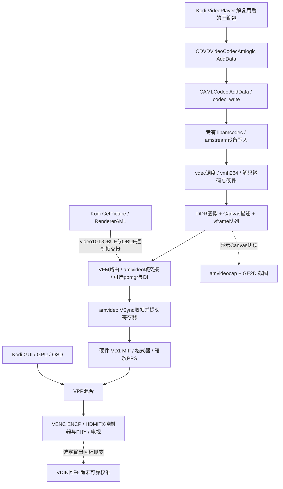

# E900V21C：最新基线、借鉴来源与播放代码导航

更新：2026-11-21。面向代码接手；实机状态以 [阶段收尾](boards/HANDOFF-20261121.md) 为准。**硬解黑屏未修复，故障尚未定位到单个硬件模块。** 不应把下面的代码调用关系当成每一级像素已实测正常。

## 1. 实际构建基线

本地仓库：`/Users/lql/Downloads/IPTV/CoreELEC-E900V21C/github-CoreELEC`，分支 `e900-gxlx2-cloud`。本文件更新前 HEAD 为 `989633b`。

| 部分 | 实际版本/来源 | 定义入口 |
|---|---|---|
| 系统与构建框架 | CoreELEC 21.3 NG / Omega，`fc61125e8900ab0c2593a29b615980ed0cd5b939` | [pins.json](pins.json)、[CLOUD.md](CLOUD.md) |
| 内核 | CoreELEC/linux-amlogic，4.9.269，`50c8e8154c5aba3c7cd8438d04dd5fdd51733e41` | [Linux package.mk](../projects/Amlogic-ce/packages/linux/package.mk) |
| 解码媒体模块 | CoreELEC/media_modules-aml，`60561618f2bf154c1438d3c790b625ff01f215c3` | [media package.mk](../projects/Amlogic-ce/packages/linux-drivers/amlogic/media_modules-aml/package.mk) |
| Kodi | CoreELEC/xbmc，`acc0fc66bc6af69c31a93c5d17e36900343263b7` | [CE Kodi package.mk](../projects/Amlogic-ce/packages/mediacenter/kodi/package.mk)；不能用通用目录中的21.2版本代替 |
| libamcodec | NG版本 `8a779caba41b163fed9ebd0df82db36dd962a9a3`，预编译专有库 | [package.mk](../projects/Amlogic-ce/packages/multimedia/libamcodec/package.mk)，来源 sources.coreelec.org；不是能完整追踪的开源实现 |
| 编译环境 | Ubuntu 22.04，linux/amd64 | `pins.json`；镜像标签未锁digest |
| 板级 | CE同内核 `gxl_p212_1g.dts` 为起点，对照Android `gxlx2_p291_1g` | [板级说明](boards/README.md)、[板级补丁](patches/linux/0003-e900v21c-usb-board.patch) |

目标硬件为 S905L3-B/GXLX2，CPU major 0x2a，P291，1GB内存。当前采用USB启动；eMMC、SD/SDIO及无线没有完成适配，不代表完整支持全部外设或全部硬解格式。

### 相对固定基线，具体改了什么

修改集中在板级启动、SoC识别、媒体寄存器访问和显示配置选择；没有重写解码算法。下表描述修改内容，不表示每项功能都已通过实机验收。

| 部分 | 相对基线的改动 | 主要代码入口 |
|---|---|---|
| SoC识别 | 增加GXLX2真实CPU ID `0x2a`、判断函数及解码模块匹配，避免未知型号或仅按ID大小误选路径 | Linux 0001；media 0001 |
| 板级DTB | 从同内核的`gxl_p212_1g`派生本机DTB，调整1GB内存、保留区、framebuffer、HDMI及USB配置；eMMC等未完成外设保持禁用 | Linux 0003；`boards/gxlx2_p291_1g_e900v21c.dts` |
| USB启动 | 增加适合当前Android bootloader的`booti`脚本、镜像布局及打包部署流程；没有重写bootloader | `boards/e900-usb-booti.src`；`scripts/prepare-usb-image.py` |
| HDMI访问 | 增加可选的GXLX2直接寄存器访问方式，保留GXL PHY配置，没有整体套用G12显示栈 | Linux 0002 |
| 媒体基础设施 | 补媒体寄存器总线注册；处理缺失DI时钟；解码模块加入GXLX2时钟注册及实际微码选择日志 | Linux 0005/0006；media 0001/0002 |
| 解码通道 | 将GXLX2的VLD DMC通道选择调整为legacy bit13；未修改H.264解码算法 | media 0003 |
| 视频显示策略 | 在两处初始化判断中排除GXLX2，保留legacy VPP混合和MIF寄存器表；跳过不支持的POST2矩阵访问。尚未解决硬解黑屏 | Linux 0007/0008 |
| 截图与诊断 | GE2D截图等待转换完成后再释放Canvas；加入VDIN路由、DMA生命周期、完成状态快照和显示阶段日志；另有启动/MIF/晚初始化实验开关 | Linux 0004、0009–0018；主要用于观测，不等于播放修复 |
| 构建工程 | 增加Actions、增量缓存、失效下载源处理、产物导出、USB镜像准备及检查脚本 | `.github/workflows/e900-coreelec.yml`；`scripts/`；`tests/` |

本项目没有对Kodi播放逻辑作实质修改，也没有修改专有`libamcodec`库；继续使用上述固定基线的VideoPlayer、Amlogic接口及预编译库。微码选择日志、通道/时钟配置修改也不等于修改了微码内部算法。

优先审阅的三个功能差异：[0008 legacy VPP/MIF选择](patches/linux/0008-gxlx2-legacy-video-pipeline.patch)、[0006 媒体总线注册](patches/linux/0006-gxlx2-direct-media-register-buses.patch)、[media/0003 VLD DMC通道](patches/media/0003-gxlx2-vld-dmc-channel.patch)。它们是值得核对的差异，不是已确认的黑屏根因。

在仓库根目录查看源码适配差异：

```sh
git diff fc61125e8900ab0c2593a29b615980ed0cd5b939 HEAD -- \
  e900-port/patches e900-port/boards/gxlx2_p291_1g_e900v21c.dts
```

Linux和媒体模块源码在构建时下载，再应用补丁，因此主仓库diff主要显示新增补丁文件。上面命令查看已提交内容；尚未提交的修改另用`git diff`查看。

### 源码补丁和当前运行镜像的区别

* 仓库中 Linux 0001–0003处理身份、HDMI访问及板级；0005–0008处理DI可选时钟、媒体总线、POST2及legacy视频策略；media 0001–0003处理身份/微码日志、解码时钟及VLD DMC选择。补丁均在 [patches](patches/)，不能据“存在补丁”认定全部功能已验收。
* Linux 0004、0009–0018包含启动、MIF、初始化、GE2D/VDIN和阶段观测等实验/诊断；部分有默认关闭的参数。`gxlx2_late_video_init=1`曾导致重启，不作为可用修复。
* 当前USB是 **Image277 + SYSTEM214 + DTB214 + uInitrd214**。Image277在源构建Image240基础上继续做过二进制诊断修改；Image240来自云任务44763949632、源码c63e226。**直接按仓库源码构建，不会自动得到字节相同的Image277。**
* Image277重建材料保存在仓库外 `../trial-map277/`（从仓库根目录计算），含 `prepare.py`、`map.py`、`manifest.json`、`stub.asm` 和读回记录。其四组固定只读寄存器探针默认预算0。旧Image的mode2/3隔离及275/276时钟位语义已不适用于277。
* “源码补丁可读”“ARM构建通过”“临时镜像实机效果”是三个不同状态；逐次实验见 [DISPLAY-STAGE-HOOKS](boards/DISPLAY-STAGE-HOOKS.md)，不以早期README中的待办替代最新收尾状态。

## 2. 借鉴了哪些项目

| 项目/资料 | 实际用途 | 是否成为当前CE代码基线 |
|---|---|---|
| CoreELEC/CoreELEC、linux-amlogic、media_modules-aml、xbmc | 构建、BSP内核、解码驱动、播放器 | 是，以上固定版本 |
| 本机可启动Android底包及备份 | 原厂DT、内存/保留区、遥控码、3.14符号/反汇编参照 | 板级与行为对照；没有整体替换CE内核 |
| ophub/amlogic-s9xxx-armbian | 救砖底包、外置引导、DT/eMMC经验；曾用于验证Linux可启动 | 否；Armbian能启动不证明CE硬解显示正常 |
| sormy/tvbian，`90185b682c9ab9cfd6409e65e7d05d3124fe1f4a` | 同GXLX2/P291的主线显示、解码及像素对比方法；其目标板2GB | 仅研究参考，未集成到CE4.9 |
| Zinan Zhou 2026-07-18 GXLX2 HDMI RFC、ophub #3604/#3650 | GXL显示/PHY与直接映射HDMI访问的模块区别 | 核对架构；不是当前VD1黑屏已验证修复 |
| Linux v6.18 meson DRM、ChalesYu/extdrv4openwrt、windyard/android-box-to-linux | 比较初始化/访问方式、显示排查方法 | 参考；未切换为主线DRM栈 |
| S905X Rev0.2数据手册 | MUX、同步、GEN时钟/复位位定义参照 | GXL家族参考，不能视为GXLX2完整规格 |

原始链接、适用范围及未验证部分集中在 [社区资料核查](boards/GXLX2-COMMUNITY-RESEARCH-20261121.md)。用户给出的 #2447/#1256/#1514/#939 已记录；没有逐条审计全部历史评论/附件，不能称为全部资源已穷尽。

## 3. 从点击播放到电视的实际路径

下面按H.264硬解说明。箭头同时包含数据流和异步交接，不是同一线程中的连续函数调用。



**GE2D截图不是经过VD1/PPS后的截图；VDIN不是每帧必经的显示环节。** Kodi普通截图主要覆盖GUI/OSD，不能据此判定硬件视频平面内容。VD1、格式器、PPS在硬件内部处理像素；下面C函数主要配置寄存器，不存在能在每个函数出口直接拿到完整中间图像的通用软件缓冲。

### 逐文件阅读顺序

为方便本地跳转，整理了15个源码阅读副本到 `../../coreelec-audit/playback-code/`。新取的Kodi、amstream、vmh264、VFM/amlvideo文件按上述固定commit下载；其余由既有audit源码整理。副本保留上游行号，**不是应用CE包补丁及本项目补丁后的构建树**。URL与副本SHA256见 [sources.json](../../coreelec-audit/playback-code/sources.json)。以下行号均针对阅读副本，修改时应回到构建树或项目补丁生成入口。

| 顺序 | 文件与关键行 | 应看什么 |
|---|---|---|
| 1 | [DVDVideoCodecAmlogic.cpp](../../coreelec-audit/playback-code/kodi/xbmc/cores/VideoPlayer/DVDCodecs/Video/DVDVideoCodecAmlogic.cpp)：Open 95、AddData 410、OpenDecoder调用500、AddData调用509、GetPicture 541 | 格式选择、H.264码流转换、压缩包送入CAMLCodec；GetPicture返回CAMLVideoBuffer标识及时间信息 |
| 2 | [AMLCodec.cpp](../../coreelec-audit/playback-code/kodi/xbmc/cores/VideoPlayer/DVDCodecs/Video/AMLCodec.cpp)：codec_write 635/693、OpenDecoder 1861、codec_init 2172、OpenAmlVideo 2221附近、AddData 2415、ReleaseFrame 2581、DQBUF 2632、GetPicture 2654、SetVideoRect 2790 | libamcodec调用边界；`/dev/video10`帧编号/PTS交接；窗口位置和显示控制。ReleaseFrame是QBUF交接，不应只按函数名理解为释放图像内存 |
| 3 | [RendererAML.cpp](../../coreelec-audit/playback-code/kodi/xbmc/cores/VideoPlayer/VideoRenderers/HwDecRender/RendererAML.cpp)：Configure 51、AddVideoPicture 100、RenderUpdate 185 | Renderer调用ReleaseFrame、SetVideoRect、PollFrame；硬解路径不是把每帧YUV上传到OSD纹理再输出 |
| 4 | [amstream.c](../../coreelec-audit/playback-code/media/drivers/stream_input/amports/amstream.c)：video_port_init 644、vbuf_write 1185、vframe_write 1213、open 1706、ioctl 3891；[vdec.c](../../coreelec-audit/playback-code/media/drivers/frame_provider/decoder/utils/vdec.c)：create 1129、connect 2199、init 2390、core_thread 3489 | 输入口、stream/frame两种喂数方式、解码实例和异步调度。具体走哪种write取决于实际设备节点/模式，不能凭multi实例名称推定 |
| 5 | [h264_multi/vmh264.c](../../coreelec-audit/playback-code/media/drivers/frame_provider/decoder/h264_multi/vmh264.c)：post_video_frame 2919、prepare_display_buf 3275、vf_peek 4295、vf_get 4329、ISR线程6634、ISR7531 | 本次实例是ammvdec_h264-00，应读这个multi驱动，而非只读h264/vh264.c。关注Canvas、type、尺寸、display_q及VFRAME_READY通知；像素解码还涉及微码/硬件 |
| 6 | [vframe_provider.c](../../coreelec-audit/playback-code/linux/drivers/amlogic/media/common/vfm/vframe_provider.c)：vf_peek 483、vf_get 499；[vfm.c](../../coreelec-audit/playback-code/linux/drivers/amlogic/media/common/vfm/vfm.c)；[amlvideo.c](../../coreelec-audit/playback-code/linux/drivers/amlogic/media/video_processor/video_dev/amlvideo.c)：vf_get 159、QBUF549、DQBUF571 | VFM是按名称连接provider/receiver的队列网络。amlvideo DQBUF从上游取帧、QBUF把q_omx推进q_ready并通知下游。必须读实际运行时map，不能假设永远是decoder直连amvideo |
| 7 | [video.c](../../coreelec-audit/playback-code/linux/drivers/amlogic/media/video_sink/video.c)：video_vf_get 1262、ext_get_cur_video_frame 1436、primary_render_frame 4168、vsync_isr 6723；同文件6507调用primary_render_frame、6641调用vpp_blend_update | amvideo接收、PTS/VSync时序、当前帧切换、每帧配置提交。1436是GE2D取当前显示Canvas的旁路入口 |
| 8 | [video_hw.c](../../coreelec-audit/playback-code/linux/drivers/amlogic/media/video_sink/video_hw.c)：vd1_path_select 671、vd1_set_dcu 780、vd1_mif_setting 1768、config_vd_pps 4340、vpp_blend_update 4829、set_layer_display_canvas 5332、layer_swap_frame 5480 | 本次最值得对照的配置区：legacy/G12分支、Canvas0、GEN/GEN2、Y/C位置及格式、PPS与blend。函数名不是实际像素取点；寄存器经VSync/RDMA提交也有时序区别 |
| 9 | [hdmi_tx_video.c](../../coreelec-audit/playback-code/linux/drivers/amlogic/media/vout/hdmitx/hdmi_tx_20/hdmi_tx_video.c)：hdmitx_set_display 940；[hdmi_tx_hw.c](../../coreelec-audit/playback-code/linux/drivers/amlogic/media/vout/hdmitx/hdmi_tx_20/hw/hdmi_tx_hw.c)：PHY1904、config_hdmi20_tx 4632、set_hw5464；[reg_ops.c](../../coreelec-audit/playback-code/linux/drivers/amlogic/media/vout/hdmitx/hdmi_tx_20/hw/reg_ops.c) | 输出模式、PHY和控制器寄存器访问。这里是配置输出端，不是每帧用户态调用 |

`AMLCodec.cpp:2170` 的 `decoder ppmgr amlvideo deinterlace amvideo` 只在 `STREAM_TYPE_SINGLE` 分支设置，不能把这一字符串直接当作multi实例本次播放的已确认完整路由。ppmgr、DI可能旁路或参与，需结合实机map与帧type判断。这里刻意保留该未核对边界。

## 4. 现在证据停在哪里

| 阶段 | 已知 | 尚不能推出 |
|---|---|---|
| 压缩包→H.264硬解→DDR/显示Canvas0 | 同一样片GE2D读出完整彩条，解码持续计数、报告错误0 | 不代表所有格式/码流正确；也不证明VD1真正读出这些像素 |
| VFM/amvideo及显示配置 | Canvas切换；277记录1280×720亮度/640×360色度、格式器宽1280/640，未见复位保持置位 | 配置合理不等于VD1、PPS或blend输出正常 |
| VD1读取→格式器→PPS→视频混合入口 | 仍是重点疑区；接视频回采可能无帧/旧图，断开POST视频入口可取当前通知 | 尚不能二分成某个单独硬件级故障；无帧不等于黑像素 |
| GUI/OSD及基础HDMI | 菜单和软件视频曾被用户确认正常 | 不保证叠加硬解平面时整条链路仍正常 |
| VDIN中间截图 | 262曾见彩条，267未复现；271/272 BIST未通过新鲜图案正控 | 不能用这些回采结果宣布VD1/PPS任一级已通过或已坏 |

之前RDMA旁路、VPP强制门控、GO_FIELD复位/自由时钟四组合均未形成修复。全局套用G12显示策略曾破坏OSD；反复切同类参数不能继续算定位进展。

如果从代码接手，建议先对照 **video.c / video_hw.c 的legacy路径与本机原厂正常播放配置**，再校准可靠像素取点；不要从“HDMI黑屏”直接推定H.264解码器坏了。当前没有原厂正常播放时的同组寄存器实机快照，也没有可靠的VD1/PPS独立图像抓取。这两项是接手时明确缺少的证据。
