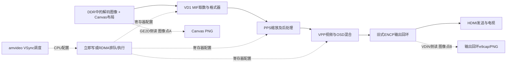

# Canvas→VD1/VPP→输出回环：处理逻辑与分析导航

> 287实测发现跨Stop回采的场景响应疑点；旧黑图暂不能作为当前输出的充分证明，见[最新验证记录](BUILD287-VALIDATION.md)。
适用固定基线及其补丁见[基线文档](../BASELINE-AND-PLAYBACK.md)。下面按函数名定位，不依赖补丁变化后的行号。源码注释随0022应用到实际Linux源文件；0023是默认关闭的GEN3单项实验，不是已验证修复。新源码已完成ARM构建并以Image287/SYSTEM287实机执行，见[287验证记录](BUILD287-VALIDATION.md)。

## 数据流和控制流必须分开阅读

CPU函数负责配置和帧交接，硬件自行处理像素。函数返回、配置值正确、输出中断增长三者都不能替代像素证明。RDMA在这里指寄存器更新引擎；图像DDR读取和VDIN向DDR回写是另外的数据通路。

## 逐段读代码及观察线索

以下函数位于`drivers/amlogic/media/video_sink/`，除注明其他目录外。上游阅读副本在工作区`coreelec-audit/playback-code/linux/`；那不是已应用补丁的构建树。

| 边界 | 函数 | 处理逻辑 | 快照/日志与判读 |
|---|---|---|---|
| 帧进入显示驱动 | `video.c: video_vf_get`、`primary_render_frame` | 取帧、关联当前frame_par、按new_vpp_setting/force条件配置硬件 | index/PTS/type/flag/bitdepth/planes、尺寸；不是每帧都重新执行DCU配置 |
| 显示Canvas选择 | `video_hw.c: set_layer_display_canvas`、`layer_swap_frame` | 为帧平面设置/复制Canvas槽位，选择显示索引并排队更新 | input的来源/目标Canvas；live/queued索引；canvas_cache仅是软件描述，不是硬件LUT回读 |
| 图像点A | `video.c: ext_get_cur_video_frame`；`amvideocap.c`同步GE2D路径 | 经既有capture生命周期侧读当前显示Canvas | 实际PNG和原始BGR；有效图像证明这一侧取得数据，不能证明VD1读出数据；完成枚举为十进制300 |
| VD1取数/格式控制 | `video_hw.c: vd1_set_dcu`、`vd1_path_select` | MIF/AFBC选择、布局、位深、burst、格式与重复策略 | dcu_config事件；GEN/GEN2/GEN3、FIFO、FMT；source中的legacy/G12选择必须与本机bank一致 |
| 取数窗口 | `video_hw.c: vd1_mif_setting` | 设置Y/C坐标范围与格式器宽度 | Y/C窗口、fmt_width、平面尺寸/stride/blockmode是否相容；相容不等于已输出像素 |
| 缩放/后处理 | `video_hw.c: config_vd_pps`、`vd_scaler_setting` | 前者生成软件scaler/blend设置，后者分发实际缩放配置 | SC_MISC、相位、源/目标尺寸和bypass_pps；暂无独立PPS输出图像点 |
| 视频层与OSD混合 | `video_hw.c: vpp_blend_update` | 合并层开关、输出策略和OSD状态，提交VPP_MISC及混合配置 | requested/live/shadow、VD1/OSD使能和输出窗口；单个跨VSYNC差异不是失败证明 |
| 图像点B | `viuin.c: viuin_open`；VDIN1的完成队列与snapshot复制 | 旧式编码器输出回环，经有所有权、完成及DMA同步检查的路径复制到独立文件 | 两帧时间/完成计数、真实彩条与移动白块；首播正控已通过，重播实际全黑；不是物理HDMI接收截图 |
| 停止/重播 | `video.c: video_vf_unreg_provider`；`video_hw.c: safe_switch_videolayer`、`do_vpu_delay_work` | 注销/keep/free帧、应用blackout、关层、延迟断电与时钟投票；下次注册重新配置 | provider_reg/unreg/end、layer_switch、DI分支、VPU gate/memory事件；按一次生命周期对照，不能只看enabled |

## 寄存器提交路径：解释“软件有值、硬件没值”

`primary_render_frame`及各配置函数→`VSYNC_WR_MPEG_REG[_BITS]`→根据当前模式直接写或进入`rdma_write_reg`队列→触发/IRQ完成。`rdma.gxlx2_debug_state`与`rdma_mgr.gxlx2_debug_state`只读取软件数组/队列元数据，不读取任意寄存器，也不是跨字段原子快照。

- `configure`、`completion`、`irq_dispatch`：关联模式、handle、配置/完成计数。
- `overflow_fallback`：旧实现队列满时会直接写回积累项，因此完成IRQ为0仍可能偶尔出画。不能把这种出画当作RDMA持续正常。
- `write_vc`：固定可疑寄存器在CPU写入口的请求；看不到引擎实际执行的每条写入。
- `drop_vc`：同一固定集合在总线回调缺失时被丢弃。
- `reset_request`：记录管理器复位时VC/HHI软件就绪状态，协助检查早期初始化是否丢写。

`caller`是记录函数的直接调用者，可能仅到通用包装层，不是完整原始业务调用栈。预算耗尽或日志环被覆盖都会造成缺失；缺失事件不能自动解释为未执行。不同channel的seq各自递增，跨channel用同一boot-id与内核时间关联。

## 已有证据、候选和未覆盖部分

[285成对图像及元数据](LEGACY-LOOPBACK-CALIBRATION-20261124.md)建立了以下边界：

| 场景 | Canvas侧读 | 同一旧式输出回环 |
|---|---|---|
| 新启动首播 | 彩条/白块 | 彩条，连续两帧变化 |
| Stop/replay | 仍有彩条/白块 | 连续两帧解码RGB全0，完成计数持续增加 |

这是同一启动、同一片段、同一采集会话的区间对照，**不是同一VSYNC的原子两端截取**。异常在Canvas到输出回环之间已出现；尚不能分出VD1取数、格式器、PPS或blend具体一级。无人观察电视，本轮没有验证电视最终画面及附加HDMI故障。

具体候选：GEN3首播33→重播3033；原厂3.14在对应配置处全写`0x33 | (mode << 8)`，CE legacy路径主要做部分位更新。bit12/13的确切语义未核实，不能给它们臆造功能名称。时钟也不能凭一次开函数调用就宣布物理波形正常。

二进制286没有达到预期GEN3=33，因此不能判因果。0023源码实验严格限制CPU、legacy bank、未借用VD2、明确1aa7，只请求清bit12/13，并提供提交次数和事件。后续必须同时检查：调用次数增长→请求值/CPU写入口→live是否变化→像素是否变化。提交次数只证明软件走到了调用点。

## 下一轮分析分支与停止条件

1. 默认首播/重播先复制285对照；若正控失败，先处理采集或基线，不能继续推理中间级。
2. 若默认重播复现黑图，检查源级GEN3实验是否真正请求、live是否达到33。
3. **没有请求**：看DCU触发条件、legacy/CPU/bank/mux保护及日志预算；不能判实验无效。
4. **有请求但live未变化或又恢复3033**：先沿RDMA队列、完成/溢出和后续写入找提交或覆盖问题；不改第二项显示策略。
5. **live达到33但回环仍黑**：该单项不是充分修复，恢复开关，保留完整证据，转向其余状态或新增经正控校准的中间像素点。
6. **live达到33且回环恢复运动彩条**：重复Stop/replay验证可重复性，并用用户可观察的HDMI结果验收；单次恢复不算完成。

287完整ARM构建和新hook实机取证已完成；GEN3实验未恢复输出，RDMA完成中断正常也能复现重播异常。上述分支保留为原实验设计，最新判读以[287验证记录](BUILD287-VALIDATION.md)为准。

## 新增观测实现（0027，尚待校准）

通过legacy VPP matrix probe进行VADJ1/VADJ2/postblend/OSD1输入输出候选的固定坐标采样。未确认所有selector的物理位置与GXLX2支持，不把它们直接标成VD1/PPS独立截图。保护、数据格式和校准二分流程见[中间像素观测](INTERMEDIATE-PIXEL-PROBES.md)。
