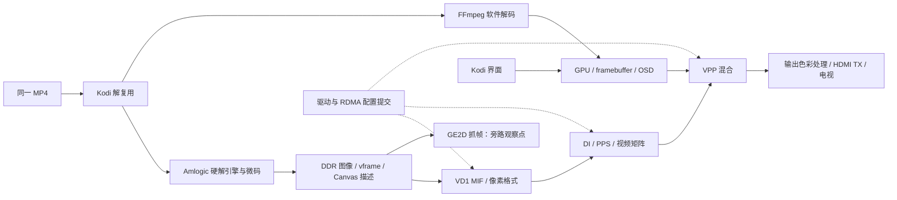

# 显示链路复盘：先区分计数、配置与像素

目前已确认 Kodi 图形界面、软件解码样片和界面音效可用。硬解样片仍黑屏，不能称为硬解验证通过。播放控件曾短暂出现，说明 OSD 支路至少能输出；按键有音效本身只证明程序仍在响应。



GE2D 抓帧从 `ext_get_cur_video_frame()` 获取帧，再通过 Canvas/GE2D 转换。它不是 HDMI 最终画面的抓取。RDMA 提交日志也不承载视频像素。

| 环节 | 已有证据 | 证据边界 |
|---|---|---|
| 文件与解复用 | 同一个 H264 MP4 软件解码可见；本地/盒子文件 SHA256 相同 | 当前黑屏不宜先归因文件损坏 |
| 硬解与微码 | 帧计数约30fps；等待GE2D完成后取得完整色条帧；当前选 `g12a_h264_multi.bin` | 当前H264样片像素可读；不能推广到其他码流、HEVC或HDMI输出 |
| DDR / Canvas / GE2D | 203对照确认BGR24；延迟读在320、640、1280宽度下均得到完整色条 | 原右侧异常主要来自异步抓帧；VD1仍可能按不同配置解释同一帧 |
| VD1 取帧和格式 | 日志证实旧/G12地址、格式bit29等配置确实按设计提交 | 提交成功不证明硬件按正确地址、stride、布局取到帧 |
| DI / PPS | 分别旁路后仍黑；本次 PPS top enable已在驱动提交中清除 | 这些单独开关不足以修复，不能排除相关初始化问题 |
| VPP / OSD | 图形界面和软件视频实测正常，硬解时控件曾短暂出现 | 只证实图形支路，不能据此认定 VD1 视频输入/混合正确 |
| HDMI TX / 电视 | 界面与软件视频可见，HDMI连接和VSYNC稳定 | 基础链路通；视频专用矩阵/位深处理仍需区分 |

## 对照帧

源文件 SHA256：`086c5742022b5430f30fa3455da8dd1d1e274a76e426545b3ca02349835da2ea`，181828字节；已核对盒子实际播放文件相同。

macOS AVFoundation 从同一文件3秒处解出1280×720参考帧：正常的白/黄/青/绿/品红/红/蓝/黑色条与移动白标。旧 GE2D 抓帧169为320×180，右侧存在原片没有的花纹。202量化分析确认BGR解读比RGB解读更接近参考。203进一步证明此前不完整抓帧不能作为解码器坏帧的依据。

203使用同一未修改内核，比较立即读取与“先读一字节、等待500ms、再读余量”。延迟读不触发第二次转换。320×180、640×360、1280×720均得到完整色条；640宽即时读取的右侧平均误差约65，延迟读取约2.2。源码中非阻塞GE2D调用随后立即释放Canvas、归还源帧并报告完成，与观测相符。该方法仍不是正式的DMA完成栅栏，首缓存行及中断/错误路径不在结论范围内。

证据：[原视频参考](evidence/h264-source-201.png)、[即时抓帧](evidence/h264-capture-203-immediate.png)、[等待后的原尺寸抓帧](evidence/h264-capture-203-delayed.png)、[量化记录](evidence/frame-readback-203.json)。参考与抓帧时间不同，移动白标位置不能直接比较；误差评估只采用静态色条区域。

0011仅对GXLX2改用现有阻塞GE2D接口，正常提交成功路径等待后再释放Canvas。它是抓帧可靠性修复，不是HDMI黑屏修复；尚未完成完整ARM构建和新驱动实机验证。其他SoC仍保留原行为。

## 初始化时序缺口

当前已链接内核的符号顺序：

```text
__initcall_vdec_reg_ops_init2
__initcall_video_init6
__initcall_gxlx2_reg_ops_late_init7s
```

`amvideom_probe()` 在早期 `video_init` 中调用 `video_hw_init()`。其 `WRITE_VCBUS_REG` 宏经 `codec_vcbus_write()` 进入 `codec_reg_write()`；如果该总线回调尚未安装，函数直接返回。读取也直接返回0。GXLX2早期注册已被跳过，七条总线直到7s才安装，因此这里有明确的早期初始化丢写/零读问题。

运行时 `vpp_hold_line=0` 与该问题一致，源码初值为8。临时恢复到8的试验确实将 MIF 提交值从 `0x38000043` 改成 `0x38400043`，用户仍报告黑屏。单独恢复这一项不足以修复，也不能代表补齐全部早期初始化。

补丁0010增加软件回调就绪查询，以及仅对 GXLX2 生效的后置视频初始化实验。默认关闭，参数为 `amvideo.gxlx2_late_video_init=1`；没有提前发布总线。宿主测试复现了未注册时丢写，并验证实际宏/分发函数/初始化包装器、全部CPU编号及错误路径。完整ARM编译、最终链接顺序和硬件播放仍待验证。该补丁尚未部署到盒子，不能称为已修复黑屏。

## 当前处理

已停止播放和临时实验，恢复全屏轴、hold_line=0、关闭RDMA日志。盒子使用未修改的run44555272578内核、legacy MIF、legacy VPP，Kodi active；无解码实例，reset_count=3、taint=4096。保留源码与日志供复盘，不继续无对照地叠加参数。

优先级：当前样片的完整帧已能经Canvas/GE2D读出，下一步验证总线就绪后的完整视频初始化，再核对VD1对同一帧的读取、视频矩阵和混合。硬解视频是否实际显示仍需物理HDMI验证。
